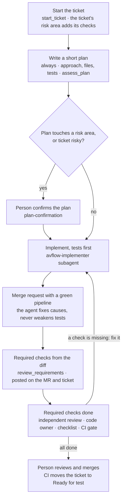

# avflow 3.0 — Design: one flow, project-defined risk

Status: **accepted** — decisions answered Nov 13, 2026 (GitLab tier still open); phase 1 built on branch `avflow-3.0-phase1` · Nov 12, 2026 · Alvin
Source: Claude Docs design doc (exported). This file is now the reference for implementation.

## Summary

avflow 3.0 replaces the four working modes with **one ticket flow**, and replaces the Mateo-specific *Machine-side* rule with **risk areas that each project defines**. The amount of process follows the risk the change actually carries — known from the ticket and from the files it touches — instead of a mode guessed before any code exists.

**Goals**

- One flow for every ticket: nothing to choose before starting, nothing to remember per mode.
- Process proportional to risk, decided from facts: the risk area the ticket writer picks, the files in the plan, and the files in the diff.
- Usable on any project: risk is described by each project (machine control, payments, migrations, security…), not built into avflow.
- Checks that are enforced, not only described: the extra steps a risky change needs are listed, required and visible in the merge request.

**Non-goals**

- Replacing CI, GitLab approvals or human review. avflow decides *which* checks a change needs and makes them visible; CI and people still judge.
- Estimating effort or splitting tickets automatically.
- Supporting other ticket systems or agents in this release (unchanged from 2.x: Redmine, GitLab, Claude Code).

## Design principles

1. **Decide from facts, not predictions.** Risk comes from what a person wrote on the ticket and from the files a change really touches — never from the agent's estimate of its own effort.
2. **Risk is known three times, and only ever goes up.** At the start (the ticket's risk area), at the plan (the files it names), at review (the files in the diff). A later step may add checks, never remove them.
3. **avflow knows *that* something is risky; the project knows *what* is risky.** Risk areas, their paths and their extra checks live in the project's repository.
4. **One source per fact.** The paths of a risk area drive both avflow's checks and the project's CODEOWNERS, so the two cannot drift.
5. **Deterministic core, judgement at the edges.** Tools compute the required checks; the agent may ask for more, with a reason, but cannot ask for fewer. A person can always add a check.
6. **Generic words in avflow, project words in the project.** No machine, panel or test bench in avflow's skills; those belong to the project's own skills and risk areas.

## The single ticket flow

Every ticket follows the same path; the only branch is a stop for plan confirmation, and the only loop is fixing a missing check.



Risk is checked three times — the ticket's risk area at the start, the planned files at the plan, the changed files at review — and each time it can only add checks. A SPIKE ticket stops after the plan step: findings as a private note, no production code.

## Risk model

A change is **high risk** when its ticket names a **risk area** (or *Other high risk*), or when its plan or its diff touches the paths of a risk area the project defined. Each risk area brings its own extra checks.

### The project's risk profile — `.avflow/project.toml`

Created by `avflow init` with commented examples; lives in the project repository and is reviewed like code.

```toml
[project]
name = "Mateo_v2"

[[risk.area]]
name   = "Machine control"
paths  = ["source/Zmotion/**", "source/MachineModes/**", "source/NullingModes/**"]
owners = ["@q"]
checks = ["plan-confirmation", "independent-review", "code-owner",
          "checklist:Tested on the test bench by someone other than the author"]

[[risk.area]]                # one of the common areas written by avflow init
name   = "Build and CI"
paths  = [".gitlab-ci.yml", "build/**"]
owners = ["@alvin"]
checks = ["code-owner"]

[risk.other]                 # the ticket's "Other high risk" choice
checks = ["plan-confirmation", "independent-review"]

[risk.default]               # optional: every change that matches no area (new projects)
checks = ["plan-confirmation", "independent-review"]
until  = "2026-12-31"
```

- `paths` are glob patterns relative to the repository root; they may point to folders that do not exist yet.
- An area may have **no paths yet** — it is then recognised only from tickets that name it (see *New projects*).
- A change can match several areas; it gets the **union** of their checks.
- `[risk.default]` applies to every change that matches no area, until its `until` date or until it is removed; without it, such changes follow the standard flow.

### The ticket's risk area

The ticket writer picks the **risk area** the work belongs to, from the names in the project's profile, plus **Other high risk** (risky, but no area fits yet) and **None**. This replaces *Machine-side*, and works before anyone knows the files. Storage is a team setting: a list custom field (any name), or the *Size and mode* line of the description (`Risk area: Payments`). The agent may raise it — pick an area or *Other high risk*, with a reason in a private note; only a person can lower it.

### When risk is determined

| Moment | Facts used | Tool | Effect |
| --- | --- | --- | --- |
| Start | The ticket's risk area | `start_ticket` | That area's checks (or `[risk.other]`) apply from the first step |
| Plan | Files named in the agent's plan | `assess_plan` | Areas matched by planned files add their checks — for example a stop for plan confirmation |
| Review | Files changed in the merge request | `review_requirements` | Final list of required checks, posted on the MR and on the ticket; files of a high-risk ticket that match no area are flagged as profile gaps |

The list only grows: a check required at the plan stays required at review, even if the diff no longer touches that area.

## New projects

A project that starts from nothing has no paths to match, but it is not without knowledge of its risks; four mechanisms cover it until the paths exist.

| Mechanism | What it gives | Until |
| --- | --- | --- |
| **Stack presets** applied by `avflow init` | The areas whose paths follow the stack's conventions — dependencies, data migrations, configuration, CI, infrastructure — plus suggested areas for the stack's own risks (see *Stack presets*) | Always; the project removes or edits what it does not need |
| **Areas by concern** | Areas named in the architecture work (payments, auth, hardware control, personal data) with `paths = []`; tickets pick them by name | Paths are added once the folder structure is decided — ideally in the ADR that fixes the structure |
| **Strict default** | `[risk.default]`: plan confirmation and independent review for every change outside known areas, because the first weeks shape the architecture | Its `until` date, or removal when the profile covers the real risks |
| **Gaps from evidence** | `review_requirements` flags files of high-risk tickets that match no area; `avflow risk suggest` collects them and proposes paths to add | Ongoing; a person accepts each change through a merge request |

The profile therefore matures with the project: concerns first, then paths, then evidence — and a change that slips through an incomplete profile is still caught by the ticket's risk area, the strict default, or review.

### Stack presets

The domain decides **which** concerns are risky; the stack decides **where** many of them live, and adds risks of its own. Presets capture the stack part once, for every project.

**Detection.** `avflow init` reads the repository and applies every preset that matches — a .NET backend with a Node frontend gets both. An empty repository takes `--stack dotnet` (or several, `--stack dotnet,node`).

| Preset | Detected by | Dependencies | Data migrations | Configuration | Suggested stack areas (commented out) |
| --- | --- | --- | --- | --- | --- |
| .NET | `*.sln`, `*.csproj` | `**/*.csproj`, `Directory.Packages.props`, `**/packages.lock.json` | `**/Migrations/**` (EF Core) | `**/appsettings*.json`, `**/*.config` | Native interop (`**/*Interop*.cs`, `**/NativeMethods*.cs`); installers (`**/*.wixproj`) |
| Node | `package.json` | `**/package.json`, `package-lock.json`, `pnpm-lock.yaml`, `yarn.lock` | `**/migrations/**`, `prisma/migrations/**` | `.env*`, `config/**` | Schema (`prisma/schema.prisma`); build tooling (`vite.config.*`, `webpack.config.*`, `tsconfig*.json`) |
| Python | `pyproject.toml`, `requirements*.txt` | `pyproject.toml`, `requirements*.txt`, `uv.lock`, `poetry.lock` | `**/migrations/**` (Django), `alembic/versions/**` | `**/settings*.py`, `.env*` | Framework settings (`**/settings*.py`) |
| Java | `pom.xml`, `build.gradle*` | `**/pom.xml`, `**/build.gradle*`, `gradle/libs.versions.toml` | `**/db/migration/**` (Flyway), `**/db/changelog/**` (Liquibase) | `**/application*.yml`, `**/application*.properties` | Security configuration (`**/*SecurityConfig*.java`) |
| Go | `go.mod` | `go.mod`, `go.sum` | `**/migrations/**` | `config/**`, `.env*` | API contracts (`**/*.proto`) |

**Shared by every preset:** CI (`.gitlab-ci.yml`, `.github/workflows/**`) and infrastructure (`Dockerfile*`, `docker-compose*.yml`, `infra/**`, `**/*.tf`, `k8s/**`, `helm/**`).

**Rules**

- A preset **writes a copy** into `.avflow/project.toml`; the project owns it from then on. A newer avflow never changes a project's profile silently: `avflow risk check` reports when a preset gained paths, and the project adds them by merge request.
- Suggested stack areas are written **commented out**, with a one-line reason, so the project decides; preset paths that match nothing in the repository yet are kept, because they describe where the code will go.
- Presets live in avflow and improve with every project; an organisation can add its own (for example a WPF + Zmotion preset that marks *Machine control* paths) in its team settings.
- **Domain areas stay the project's job**: no preset can know where your money moves or your machine is driven.

## Checks catalogue

Projects compose risk areas from a **fixed list of checks**; avflow implements each one, so a project never writes logic.

| Check | What it requires | Who or what enforces it |
| --- | --- | --- |
| `plan-confirmation` | The agent stops after the plan and waits for the assignee to confirm before any code | Skill `tickets` + tool `assess_plan`, which returns *stop* |
| `independent-review` | Two-stage review (spec, then code quality) by the `avflow-reviewer` subagent in a fresh context; result posted on the MR | Skill `qa-agent`; CI job `avflow-risk-check` looks for the review result on the MR |
| `code-owner` | Approval of the MR by one of the area's `owners` | CODEOWNERS (generated from the profile); CI job checks the approvals |
| `checklist:<text>` | A ticked checkbox with that text in the MR description, ticked by a person | MR template section written by `review_requirements`; CI job checks it is ticked |

**Always required, whatever the risk:** tests for each acceptance criterion, a green pipeline, a person's review and merge, a handoff note. These are the standard flow, not checks.

**The CI job `avflow-risk-check`** (added by `avflow init`) is what turns the list into a gate. On every merge request pipeline it reads the profile, matches the changed files, and fails with a clear message when a required check is missing — so a risky change cannot merge with an unticked checklist, no review result or no owner approval.

**Open point — GitLab tier.** Required code-owner approval is a GitLab **Premium** feature. On GitLab Free, CODEOWNERS shows the owners but does not block the merge; the `avflow-risk-check` job then provides the block by reading the MR's approvals through the API. To confirm on Enclave's GitLab before implementation.

## Where settings live

Three levels, each owned by the person who decides it; a lower level never repeats a higher one.

| Level | File | Owner | Holds |
| --- | --- | --- | --- |
| **Team** (organisation) | `team/avflow-team.toml` in avflow-dev, shipped with each release | PM / tool owner | Ticket system URL, status and field names (including the risk-area field), GitLab host, coding workflow, guardrails, models, context monitor |
| **Project** | `.avflow/project.toml` in the project repository | Project lead, reviewed by MR | Risk areas: paths, owners, checks; `[risk.other]`, `[risk.default]`; protected branches if they differ |
| **Ticket** | The ticket | Ticket writer | Risk area, Hotspot, scope, acceptance criteria |
| *(Personal)* | `~/.avflow/config.toml` | Member | Only overrides agreed with the PM |

Protected branches move from the team level to the project level, because branch names differ between projects; the team value stays the default.

## Changes per component

Most of avflow stays; the changes concentrate on how the amount of process is decided.

| Component | 2.x | 3.0 |
| --- | --- | --- |
| MCP `start_ticket` | Requires Mode; refuses without it | No Mode. Still refuses: not assigned, not Ready, blocked. Returns the checks of the ticket's risk area |
| MCP `set_fields` | Mode, Machine-side, Hotspot | Risk area (raise only), Hotspot |
| MCP — new `assess_plan` | — | Input: planned files. Output: matched areas, added checks, *stop for confirmation* or *continue* |
| MCP — new `review_requirements` | — | Input: the MR's changed files. Output: final required checks and profile gaps; posts them on the MR and the ticket |
| Skill `choose-mode` | Chooses DIRECT / PLAN / FULL / SPIKE | **Removed** |
| Skill `workflow` | Requirements per mode | One flow; which subagent does each step; how to satisfy each check |
| Skill `tickets` | Mode before start | Plan note always; `assess_plan`; `review_requirements` before submit for review |
| Skill `ticket-writer` | Machine-side line | Picks the risk area from the profile; `Risk area:` in the *Size and mode* line |
| Skills `qa-agent`, `release`, `incident`, `zoom-out` | Mention machine-side, test bench, simulator, site visit | Generic words: high risk, risk area, customer environment; project details come from the profile and project skills |
| Subagents | planner, implementer, reviewer | Unchanged; the reviewer is triggered by `independent-review` instead of by FULL |
| SPIKE | A mode | A ticket type: tracker *Spike*, or `Type: spike` in the *Size and mode* line. No production code, findings as a private note |
| `avflow init` | Team files + CI | Also `.avflow/project.toml` with the stack presets' areas (detected, or `--stack`), the `avflow-risk-check` CI job, and CODEOWNERS generated from the profile |
| New `avflow risk` | — | `check` validates the profile; `files <paths>` shows which areas and checks apply; `sync` regenerates CODEOWNERS; `suggest` proposes paths from profile gaps |
| `avflow release-notes` | Marks **[machine-side]** | Marks the risk area names, for example **[Machine control]** |
| `avflow report` | — | Adds: share of high-risk changes per area, checks missing at review, and profile gaps |

## Examples

The same flow gives different checks, only because the projects define different risk areas.

**A generic web app** — `.avflow/project.toml`:

```toml
[[risk.area]]
name   = "Payments"
paths  = ["src/billing/**", "src/webhooks/stripe/**"]
owners = ["@lead"]
checks = ["plan-confirmation", "independent-review", "code-owner",
          "checklist:Refund and failure paths tested"]

[[risk.area]]
name   = "Auth"
paths  = ["src/auth/**", "src/middleware/session*"]
checks = ["independent-review", "code-owner"]

[[risk.area]]
name   = "Database migrations"
paths  = ["db/migrations/**"]
checks = ["independent-review", "checklist:Rollback tested on a copy of production data"]
```

**What happens to four tickets**

| Ticket | Project | Facts | Required checks |
| --- | --- | --- | --- |
| Rename a label on the order screen | Mateo | No risk area; diff `source/Views/OrderWindow.xaml` | Standard flow only |
| Add a pause command to the motion sequence | Mateo | Risk area Machine control on the ticket; diff `source/Zmotion/ZCommand.cs` | Plan confirmation, independent review, code owner (@q), *Tested on the test bench…* |
| Show invoice totals on the dashboard | Web app | No risk area; diff `src/ui/dashboard/**` | Standard flow only |
| Retry failed Stripe webhooks | Web app | No risk area; plan names `src/webhooks/stripe/retry.ts` | From the plan: stop for confirmation. At review: independent review, code owner, *Refund and failure paths tested* |

The fourth row is the case the old modes missed: nobody flagged the ticket, but the plan named a risky file, so the checks were added before any code — and confirmed again at review.

## Migration from 2.x

No ticket needs editing; members run `avflow update` and one command per project.

| 2.x | 3.0 behaviour |
| --- | --- |
| Mode field / `[avflow] mode=` notes | Ignored. The field can stay in Redmine; it is no longer read |
| Machine-side field or line | Read as risk area **Other high risk** until mapped: the team setting `machine_side_area = "Machine control"` maps Mateo's *yes* to that area; the line parser accepts `Machine-side:`, `High risk:` and `Risk area:` |
| Ticket in progress under DIRECT / PLAN / FULL | Continues; at review, `review_requirements` lists the checks from the profile |
| Sensitive paths in `CLAUDE.md` / `CODEOWNERS` | Moved into `.avflow/project.toml` risk areas; `avflow risk sync` then regenerates CODEOWNERS |
| Machine-specific text in avflow skills | Moves to Mateo's own project skills (for example `mateo-machine-review`) |

**Per project, once:** run `avflow init` (adds `.avflow/project.toml` with examples and the CI job), describe the risk areas, `avflow risk check`, `avflow risk sync`, merge.

**Version.** 3.0.0 — breaking for the ticket flow (no Mode) but not for installation: `avflow update` works from 2.6.x.

## Trade-offs and risks

The design trades an early, explicit choice for checks driven by facts; these are the costs.

| Risk | Effect | Mitigation |
| --- | --- | --- |
| A risk area is missing from the profile | A risky change gets only the standard flow | The ticket's risk area still works; profile gaps are flagged at review and collected by `avflow risk suggest` |
| New project with no paths yet | Path matching finds nothing | Stack presets, areas by concern picked on tickets, and the strict default (*New projects*) |
| Paths drawn too wide | Every change needs extra checks; people stop reading them | `avflow risk files` shows the effect before merging the profile; start narrow, widen with evidence |
| The plan names no risky file but the diff touches one | No stop for plan confirmation; checks arrive only at review | Review still blocks the merge; the miss is reported so the profile or the plan quality can improve |
| No upfront moment to think | Less deliberate start than the old FULL | A short plan note is mandatory for every ticket; risky areas can require `plan-confirmation` |
| The CI gate depends on GitLab APIs and the tier | Owner approval may be checkable only through the API on GitLab Free | Verify before building; until then the job reports instead of failing |
| More files to understand (`project.toml`) | One more concept for project leads | `avflow init` writes commented examples and the preset areas; one page in the user guide |

What is **not** traded: the ticket rules in code, the guardrails, the secret scans, tests in every change and a person's review all stay as they are.

## Decisions, effort and phases

About 4–4.5 working days in three phases; each phase ends usable.

**Decisions needed before building** (record the answers in `docs/decisions.md`)

Answered Nov 13, 2026 — see `docs/decisions.md` (3.0).

- [x] Approve removing the four modes (one flow for every ticket). — **Yes.**
- [x] Ticket field for the risk area. — **Both: list field when it exists, `Risk area:` line otherwise; Machine-side *yes* maps to Machine control.**
- [x] Should the CI gate **fail** the pipeline from the start, or **report only** during the pilot? — **Report only in the pilot.**
- [ ] Check Enclave's GitLab tier: is required code-owner approval available (Premium), or must the CI job check approvals? — **Open**; build the API check.
- [x] Is a mandatory short plan note acceptable for every ticket, including one-line changes? — **Yes.**
- [x] Strict default for new projects: which checks, and for how long by default? — **Plan confirmation + independent review, 6 weeks.**
- [x] Which stack presets ship first? — **All five; no Enclave WPF + Zmotion preset.**

**Phases**

| Phase | Scope | Effort | Usable after |
| --- | --- | --- | --- |
| 1 — Core | Profile file and validation, the ticket's risk area (with the Machine-side mapping), `[risk.other]` and `[risk.default]`, `start_ticket` without Mode, `assess_plan`, `review_requirements` with profile gaps, `avflow risk check/files` | 2 days | Agents follow one flow; required checks listed on MR and ticket |
| 2 — Enforcement and new projects | `avflow-risk-check` CI job (report-only switch), CODEOWNERS generation (`avflow risk sync`), checklist section in MRs, stack detection and five presets in `avflow init`, `avflow risk suggest` | 1.5–2 days | Risky changes cannot merge without their checks; new projects start with a profile |
| 3 — Words and docs | Generic wording in all skills, `choose-mode` removed, Mateo's specifics moved to its project skills, user guide, test plan, sample project with a profile | 0.5 day | Ready for the pilot |

After the pilot: tune the profile with `avflow report` data, then decide whether the CI gate fails by default.
